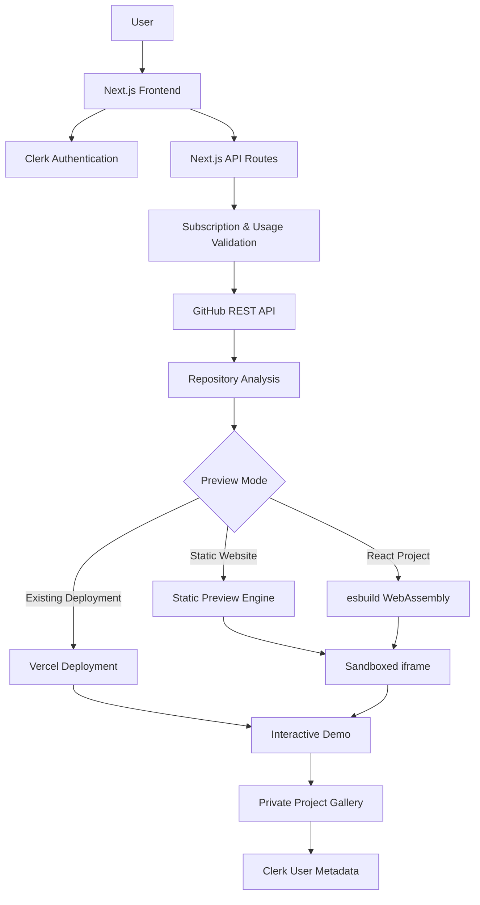

<div align="center">

# ▶️ RepoPlay

### Turn GitHub Repositories into Interactive Experiences

Discover, preview, and interact with GitHub projects directly in your browser — without cloning repositories, installing dependencies, or setting up a local environment.

[Report Bug](https://github.com/om-muddapur7/RepoPlay/issues) • [Request Feature](https://github.com/om-muddapur7/RepoPlay/issues) • [Portfolio](https://om-portfolio-plum.vercel.app/)

</div>

---

## 📖 Overview

RepoPlay is a full-stack SaaS platform that transforms compatible public GitHub repositories into interactive browser-based previews. It allows developers, recruiters, students, and non-technical users to explore software projects without the complexity of local development environments.

Simply paste a GitHub repository URL, and RepoPlay automatically detects compatible frontend projects, builds their source code, or opens an existing Vercel deployment.

Designed with security, accessibility, and developer experience in mind, RepoPlay combines Next.js, TypeScript, esbuild WebAssembly, sandboxed iframes, and Clerk to deliver an intuitive project exploration experience.

---

## ✨ Features

### 🚀 Repository Preview Engine

- 🔗 **GitHub URL Integration** – Preview compatible public GitHub repositories using their URLs.
- ⚡ **Browser-Based Execution** – Explore supported projects without local installation.
- 🌐 **Static Website Support** – Run HTML, CSS, and JavaScript websites.
- ⚛️ **React Project Support** – Preview compatible Vite and Create React App projects.
- 📦 **Frontend Extraction** – Detect and preview compatible frontend folders within full-stack repositories.
- ☁️ **Deployment Detection** – Automatically open supported existing Vercel deployments.
- 🛠️ **Source Code Bundling** – Bundle compatible frontend source code using esbuild WebAssembly.
- ⏳ **Temporary Preview Sessions** – Free and Basic previews expire after 10 minutes. Premium previews have no time limit.

---

### 👤 User Features

- 🔐 Secure authentication with Clerk
- 📊 Personal workspace dashboard
- 📚 Private project gallery on Basic and Premium
- 🕘 Previously rendered project history on Basic and Premium
- 🔄 Reopen saved projects in fresh preview sessions on Basic and Premium
- 🔍 Explore curated sample projects
- 👤 Account and subscription management
- 🌙 Light and dark themes
- 📱 Fully responsive design
- 🎨 Modern and minimalist user interface

---

### 💎 Premium Features

- 🚀 Unlimited repository previews
- ⏳ No time limit per preview
- 🔍 Compatibility checks in standard and frontend-only modes
- 💳 Integrated subscription checkout
- 📋 Subscription and plan management

### Subscription Plans

| Feature | Free | Basic | Premium |
| --- | --- | --- | --- |
| Repository previews | 2 total | 20 total | Unlimited |
| Time per preview | 10 minutes | 10 minutes | No time limit |
| Sample project library | Included | Included | Included |
| Static and compatible React previews | Included | Included | Included |
| Compatibility checks | Standard | Standard | Standard and frontend-only |
| Private gallery and reopen saved projects | — | Included | Included |
| Frontend-only demos | — | Included | Included |

Current subscription prices and additional plan benefits are displayed through Clerk Billing.

---

## 🛠️ Tech Stack

### 🎨 Frontend

<p>
  
  
  
  
  
</p>

### ⚙️ Backend

<p>
  
  
  
</p>

### 🔐 Authentication & Billing

<p>
  
  
</p>

### 📦 Preview Engine

<p>
  
  
  
  
  
</p>

### ☁️ Deployment & Data Management

<p>
  
  
  
</p>

---

## 🏗️ System Architecture



---

## ⚡ How It Works

1. **Sign In** – Authenticate securely using Clerk.
2. **Submit Repository** – Paste a public GitHub repository URL into the workspace.
3. **Validate Access** – Verify the user's subscription and available preview allowance.
4. **Analyze Repository** – Fetch repository metadata and inspect frontend entry points.
5. **Select Preview Mode** – Detect an existing deployment, static website, or compatible React application.
6. **Generate Preview** – Create a signed temporary preview link and bundle compatible source code when required.
7. **Launch Interactive Demo** – Explore the project directly in the browser.
8. **Save Project** – Record successfully rendered projects in the user's private gallery.
9. **Reopen Anytime** – Generate a fresh session for previously saved projects.

Free and Basic previews expire after **10 minutes**. Premium previews have no time limit.

---

## 📂 Project Structure

```text
RepoPlay/
│
├── app/
│   ├── workspace/          # Repository previews and gallery
│   ├── plans/              # Subscription plans
│   ├── profile/            # User account settings
│   ├── api/                # Backend API route handlers
│   ├── temporary/          # Temporary demo viewer
│   └── static-preview/     # Static preview assets
│
├── components/             # Reusable UI components
│                           # Navigation, pricing, gallery
│
├── lib/                    # Core application logic
│                           # Repository source loading
│                           # Preview signing
│                           # Account and usage management
│
├── public/                 # Public assets
│
├── proxy.ts                # Clerk middleware
├── .env.example            # Environment variable template
└── README.md
```

---

## 📋 Supported Projects

| Project Type | Support |
|---|---|
| HTML, CSS & JavaScript | ✅ Supported |
| React + Vite | ✅ Compatible projects |
| Create React App | ✅ Compatible projects |
| Full-Stack Applications | ⚠️ Frontend-only preview |
| Existing Vercel Deployments | ✅ Supported deployments |
| Backend Server Execution | ❌ Not supported |
| Database Execution | ❌ Not supported |
| Private GitHub Repositories | ❌ Not supported |
| Server-Side Environment Variables | ❌ Not supported |

RepoPlay is primarily designed for frontend project exploration. Applications requiring backend servers, databases, private API keys, or unsupported build configurations may have limited functionality.

---

## ⚙️ Run Locally

Requires Node.js 20.9 or later, npm, and a Clerk application.

```bash
git clone https://github.com/om-muddapur7/RepoPlay.git
cd RepoPlay
npm ci
```

Copy `.env.example` to `.env.local`. Set the required values below.

| Variable | Value |
| --- | --- |
| `NEXT_PUBLIC_CLERK_PUBLISHABLE_KEY` | Publishable key from your Clerk app |
| `CLERK_SECRET_KEY` | Server-side secret key from the same Clerk app |
| `PREVIEW_SIGNING_SECRET` | Random server-side secret of at least 32 bytes |
| `PAID_PLAN_SLUGS` | Optional comma-separated Clerk plan slugs. Defaults to `basic,premium` |

Generate a preview signing secret locally and paste the output into `.env.local`.

```bash
node -e "console.log(require('node:crypto').randomBytes(32).toString('hex'))"
```

Keep `.env.local` out of Git. Enable Google in your Clerk app if you want Google sign-in. Enable Clerk Billing and configure the matching user plans to test upgrades.

```bash
npm run dev
```

Open [localhost:3000](http://localhost:3000/), sign in, and paste a public GitHub repository URL into **Workspace**.

---

## Open in RepoPlay

Add this badge to a project README. Replace the host with your RepoPlay deployment and replace `OWNER` and `REPO` with the source repository details.

```markdown
[](https://YOUR-REPOPLAY-HOST/workspace?repo=https%3A%2F%2Fgithub.com%2FOWNER%2FREPO#preview)
```

The link pre-fills the workspace. Use **Check compatibility** for a report without consuming a preview, or **Create preview** to open a temporary demo.

## ☁️ Deploy on Vercel

Import the GitHub repository into Vercel with the **Next.js** preset. Add the required environment variables to the Production environment, then deploy. For a public release, use a Clerk production instance configured for the deployment domain. Subsequent pushes to the connected production branch can trigger new deployments.

---

## 📸 Screenshots

### Home Page


### Workspace


### Interactive Repository Preview


---

## 📌 API Features

- GitHub Repository Metadata Retrieval
- Repository Source Code Fetching
- Frontend Entry Point Detection
- Existing Deployment Detection
- Temporary Preview Generation
- Signed Preview Token Validation
- Preview Expiration Management
- Subscription and Usage Validation
- User Project History Management
- Private Project Gallery Management

---

## 🔒 Authentication & Security

RepoPlay uses **Clerk Authentication** and signed preview tokens to manage secure access to application resources.

- Email and Password Authentication
- Google Authentication with Clerk configuration
- Protected Application Routes
- Secure User Session Management
- Subscription-Based Access Control
- Account-Specific Preview Tokens
- Time-Limited Preview Sessions
- Sandboxed iframe Rendering
- Private User Metadata Storage
- Server-Side Preview Validation

Temporary preview links are signed and validated before access is granted. Source-built frontend previews use sandboxed iframes to provide browser-level isolation.

---

## 💳 Subscription Management

RepoPlay integrates **Clerk Billing** to provide subscription-based access to repository previews.

- Free and Paid Subscription Plans
- Preview Usage Limits
- Integrated Subscription Checkout
- Paid Plan Access Validation
- User Subscription Management
- Dynamic Pricing Information

To enable subscription upgrades locally, configure Clerk Billing and create the corresponding plans in your Clerk dashboard.


---

## 🎯 Use Cases

### 👨‍💻 Developers

- Showcase projects without requiring local setup.
- Explore open-source frontend projects.
- Share interactive software demonstrations.

### 🧑‍💼 Recruiters

- Evaluate developer portfolios through working demonstrations.
- Explore projects without cloning repositories.
- Understand project functionality beyond source code.

### 🎓 Students

- Discover and explore open-source applications.
- Learn from existing frontend implementations.
- Showcase academic and personal projects.

### 🌍 Non-Technical Users

- Explore software projects without programming knowledge.
- Interact with applications directly in the browser.
- Discover what developers have built.

---

## 📈 Future Improvements

- 🤖 AI-Powered Repository Analysis
- 📝 Automatic Project Summarization
- 📦 Support for Additional Frontend Frameworks
- 🖥️ Cloud-Based Backend Execution
- 🐳 Docker-Based Isolated Environments
- 🔒 Private Repository Support
- 🌍 Public Community Project Gallery
- 📊 Project Analytics Dashboard
- ⭐ Project Ratings and Reviews
- 📁 GitHub Account Repository Integration
- 🔗 Shareable Project Collections
- 👥 Collaborative Developer Workspaces
- 🧩 Embeddable Project Previews

---

## 🤝 Contributing

Contributions are welcome!

1. Fork the repository.
2. Create your feature branch.

```bash
git checkout -b feature/NewFeature
```

3. Commit your changes.

```bash
git commit -m "Add New Feature"
```

4. Push to your branch.

```bash
git push origin feature/NewFeature
```

5. Open a Pull Request.

If you encounter a preview-related issue, include the repository URL, preview mode, and the error displayed in the workspace.

---

## ⭐ Support

If you found RepoPlay useful, please consider giving it a ⭐ on GitHub.

Your support helps motivate future development and improvements.

---

## 👨‍💻 Author

**Om Muddapur**

- GitHub: https://github.com/om-muddapur7
- LinkedIn: https://linkedin.com/in/om-muddapur-aa56a525b
- Portfolio: https://om-portfolio-plum.vercel.app/
- X: https://x.com/Om7248

---

<div align="center">

### Stop Cloning. Start Exploring. ▶️

Made with ❤️ using Next.js, TypeScript, esbuild & Clerk

</div>
